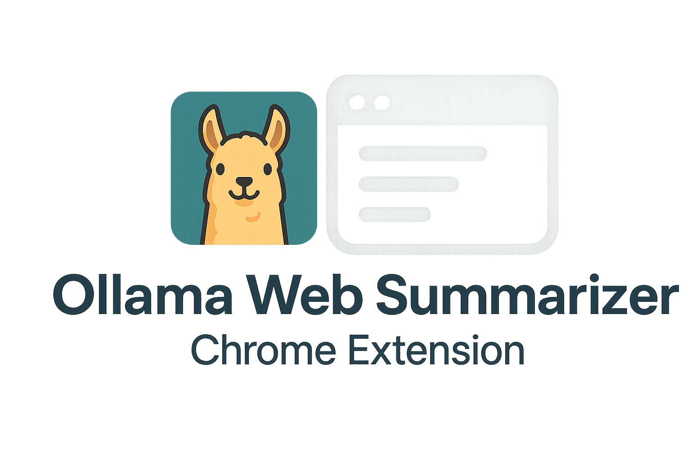

# Ollama Web Summarizer



A Chrome extension that uses your local [Ollama](https://ollama.com) models to summarize the page you are reading, explain selected text, and chat about the content. Page text and questions stay on your computer.

This is not an official Ollama product, and it is not affiliated with Ollama Inc.

## Features

- Summarize any regular webpage from the toolbar popup
- Highlight text to summarize, explain, or ask a question
- Right-click selected text for the same actions
- Chat about the current page, with streamed replies
- Auto-detect installed Ollama models, and install or remove models from the popup
- Twelve light and dark themes
- All generation happens on your machine through Ollama. The extension does not call a cloud API

## Prerequisites

- [Ollama](https://ollama.com) installed and running locally
- At least one model, for example:

```bash
ollama pull llama3.2
```

## Install from the Chrome Web Store

When the listing is published, install it from the Chrome Web Store, then finish the Ollama setup below. Until then, use the developer (unpacked) install.

## Developer install

1. Set `OLLAMA_ORIGINS` so Ollama accepts requests from this extension. See [Installation](docs/INSTALLATION.md) for Mac, Windows, and Linux, including the Mac Ollama app. After you load the extension, copy its ID from `chrome://extensions` and set:

   ```bash
   export OLLAMA_ORIGINS="chrome-extension://YOUR_EXTENSION_ID"
   ```

   For local testing you can use `chrome-extension://*`. Do not set `OLLAMA_ORIGINS` to `*`. That allows any website to call your local Ollama API.

2. Start Ollama (or use `scripts/start-ollama.sh` / `scripts/start-ollama.bat`, which set a safe default origin).

3. In Chrome, open `chrome://extensions`, turn on Developer mode, click **Load unpacked**, and select this repository folder (the one that contains `manifest.json`).

## Usage

1. Open a regular webpage (not a `chrome://` page).
2. Click the extension icon and choose **Summarize Page**.
3. Use the chat tab for follow-up questions.
4. Highlight text on the page to summarize, explain, or ask about the selection.

In the popup you can also set the Ollama URL (it must be `http://localhost` or `http://127.0.0.1`, with an optional port). The default is `http://localhost:11434`.

## Privacy

Page text, selected text, and your questions are sent only to Ollama on this computer, usually at `http://localhost:11434`. The extension stores your model, theme, and server URL in Chrome’s local storage. It does not create an account and does not send browsing data to the developer or to any third-party server.

The full policy is at [docs/privacy.html](docs/privacy.html). After GitHub Pages is enabled on this repository, it will also be available at `https://mso-docs.github.io/Ollama-Web-Summarizer/privacy.html`.

## Build a store package

```bash
./scripts/build-zip.sh
```

This writes `dist/ollama-web-summarizer-1.0.1.zip` with `manifest.json` at the zip root. Docs, helper scripts, and the large marketing PNG are left out of the package. Draft store listing text, permission justifications, and test instructions are in [docs/chrome-web-store-listing.md](docs/chrome-web-store-listing.md).

## Project structure

```
Ollama-Web-Summarizer/
├── manifest.json
├── README.md
├── src/                    # Extension source
├── icons/                  # Toolbar, store, and README images
├── scripts/                # Zip build, icon generation, Ollama helpers
└── docs/                   # Install guide, privacy policy, store drafts
```

## Troubleshooting

| Error | What to try |
|-------|-------------|
| Cannot connect to Ollama | Start Ollama, then confirm it answers at `http://localhost:11434`. On a Mac, quitting and reopening the Ollama app after you set `OLLAMA_ORIGINS` is often required. |
| 403 Forbidden | Set `OLLAMA_ORIGINS` to `chrome-extension://YOUR_EXTENSION_ID` (not `*`) and restart Ollama. |
| Model not found | Run `ollama pull <model-name>` or pick a model you already have. |
| Empty model dropdown | Make sure Ollama is running and `ollama list` shows at least one model. |
| Could not access this page | Refresh the tab, or switch to a regular `http` or `https` page. |

For complete setup notes, including the Mac Ollama app and environment variables, see [docs/INSTALLATION.md](docs/INSTALLATION.md).

## License

MIT. Copyright Mackenzie O'Brien.
